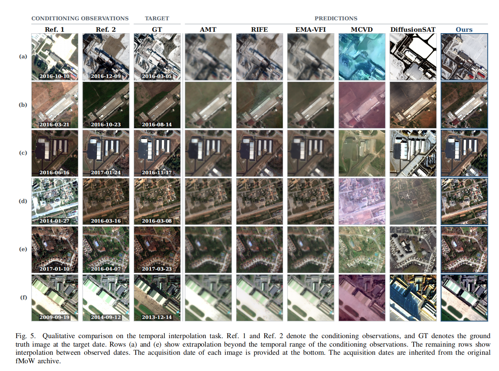
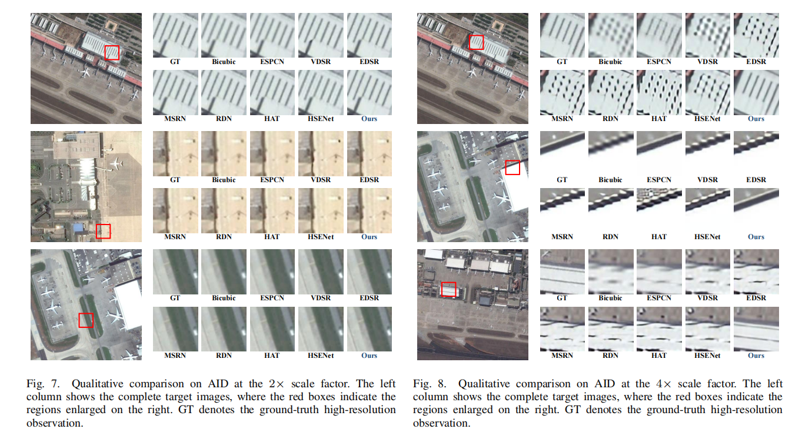
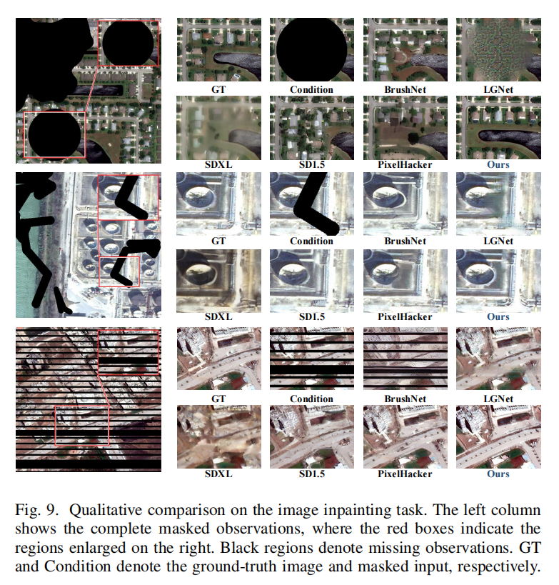
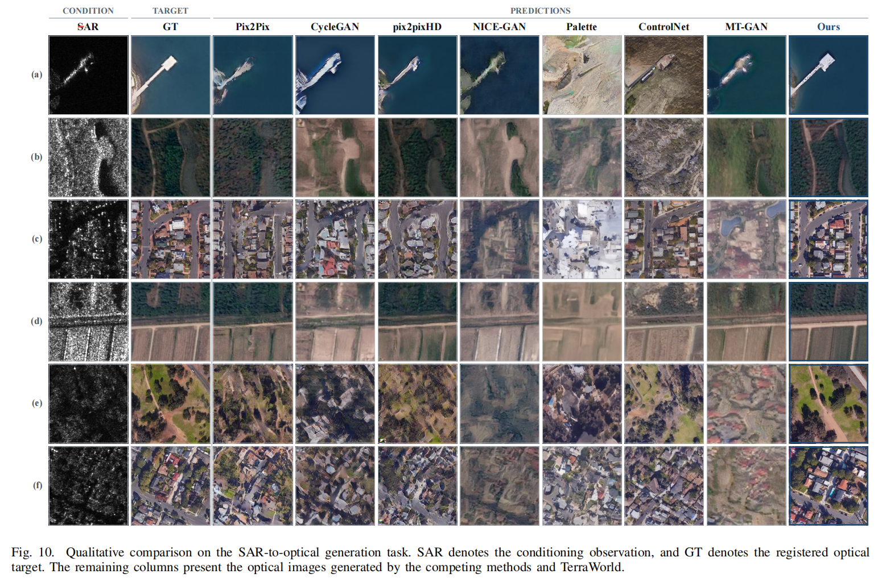
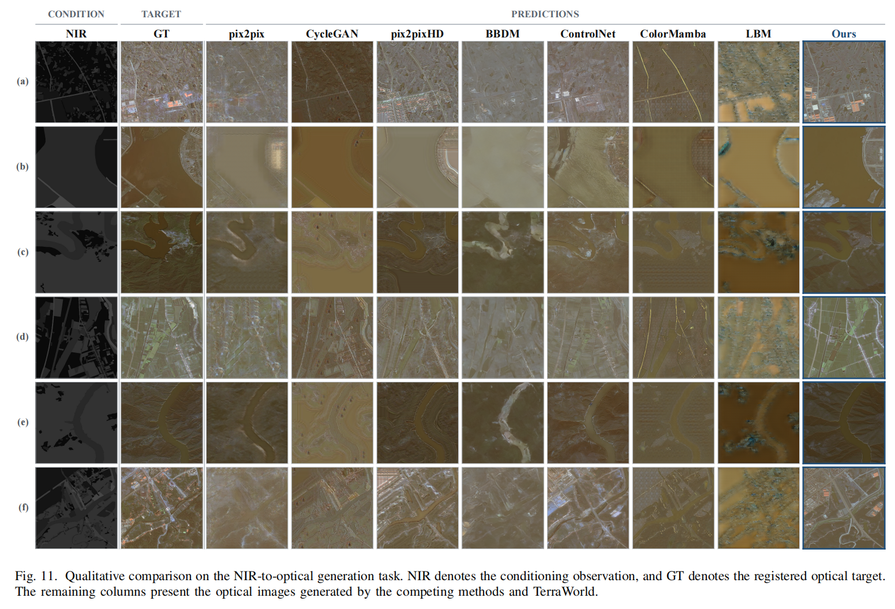

# TerraWorld

This repository contains the official implementation of the paper **TerraWorld: A Conditional Generative Foundation Model for Sparse-to-Continuous Earth Observation**.

## Qualitative results

### Temporal interpolation and extrapolation on fMOW



<details>
<summary>AID super-resolution at ×2 and ×4</summary>



</details>

<details>
<summary>Image inpainting</summary>



</details>

<details>
<summary>SAR-to-optical generation</summary>



</details>

<details>
<summary>NIR-to-optical generation</summary>



</details>

## Install the environment

Use Linux with an NVIDIA GPU and a CUDA-compatible PyTorch installation. Run the commands below and the training and inference examples from the repository root.

```bash
conda create -n terraworld python=3.10 -y
conda activate terraworld
python -m pip install --upgrade pip
python -m pip install torch torchvision
python -m pip install -r requirements.txt
```

If PyTorch cannot detect CUDA, install a PyTorch build that matches your GPU driver and CUDA environment, then install the dependencies in `requirements.txt`.

## Set external paths

Provide the datasets, model weights, and inference checkpoints required for the task you want to run. Copy the sample configuration and set the paths to your local files.

```bash
cp paths.env.example paths.env
# Open paths.env, uncomment the variables for your task, and set their absolute paths.
```

You can also export these variables before invoking a launcher. Values set in `paths.env` take precedence.

| Variable | Purpose |
| --- | --- |
| `FLUX_MODEL_DIR` | Complete FLUX.1-dev Diffusers pipeline, including the VAE, text encoders, and tokenizers |
| `FRAME_TRANSFORMER_DIR` | Pretrained Transformer for fMOW frame prediction |
| `SAR_TRANSFORMER_DIR` | Pretrained Transformer for SAR-to-optical translation |
| `INPAINT_TRANSFORMER_DIR` | Pretrained Transformer for fMOW inpainting |
| `SR_TRANSFORMER_DIR` | Pretrained remote-sensing Transformer for super-resolution |
| `FMOW_TRAIN_ROOT`, `FMOW_TRAIN_INDEX` | fMOW training data and its `index.jsonl` |
| `FMOW_TEST_ROOT`, `FMOW_TEST_INDEX` | fMOW inpainting test data and its `index.jsonl` |
| `NIR_DATA_ROOT`, `SAR_DATA_ROOT` | Paired NIR and SAR datasets |
| `AID_DATA_ROOT` | Paired AID dataset for super-resolution |

The default model and dataset paths are under `assets/models/` and `assets/datasets/` at the repository root. Each fMOW index defaults to `index.jsonl` inside its dataset directory.

For AID super-resolution, set `FLUX_MODEL_DIR`, `SR_TRANSFORMER_DIR`, and `AID_DATA_ROOT` in `paths.env`. The required directory layout and metadata are described in the [AID dataset guide](super_resolution/docs/FluxSR-FTD_AID_README.md).

## Train

Set `GPU_IDS` to the GPU indices available on your system. For translation and inpainting, use `BATCH_SIZE` to set the batch size per GPU.

```bash
GPU_IDS=0 bash translation/train/script/train_fmow_frame_prediction_more_layers_glor_control_miq_mma.sh
GPU_IDS=0 bash translation/train/script/train_nir_to_optical_more_layers_glor_control.sh
GPU_IDS=0 bash translation/train/script/train_sar_to_optical_more_layers_glor_control.sh
GPU_IDS=0 bash inpaint/train/script/train_fmow_inpaint_more_layers_glor_control_miq_mma.sh

# AID super-resolution at ×2, ×4, and ×8
EXPERIMENT=x2_glor GPU_IDS=0 bash super_resolution/train/script/train_aid_fluxsr_scale_ablation.sh
GPU_IDS=0 bash super_resolution/train/script/train_aid_fluxsr_ftd_rsbackbone_glor.sh
EXPERIMENT=x8_glor GPU_IDS=0 bash super_resolution/train/script/train_aid_fluxsr_scale_ablation.sh
```

The following example trains fMOW frame prediction on four GPUs.

```bash
GPU_IDS=0,1,2,3 BATCH_SIZE=2 \
  bash translation/train/script/train_fmow_frame_prediction_more_layers_glor_control_miq_mma.sh
```

These launchers initialize new LoRA weights from the pretrained model. Resuming the complete training state of an earlier run requires a separate implementation.

For LoRA-only super-resolution training at ×2 or ×8, set `EXPERIMENT=x2` or `EXPERIMENT=x8`. The ×4 LoRA-only launcher is `super_resolution/train/script/train_aid_fluxsr_ftd_rsbackbone_best.sh`. Set `SWANLAB_API_KEY` to log super-resolution training in SwanLab.

## Run inference

Set `CKPT` to the path of a checkpoint directory containing `text.safetensors`, `main.safetensors`, `condition.safetensors`, and `glor_control.pt`. The two MIQ-MMA tasks also require `metadata_qkv.pt`. By default, `GLOR_CKPT` resolves to `CKPT/glor_control.pt`.

```bash
CKPT=/path/to/checkpoints/frame GPU_IDS=0,1,2,3 \
  bash translation/train/script/infer_fmow_frame_prediction_more_layers_glor_control_miq_mma_rivg_stable_strong.sh

CKPT=/path/to/checkpoints/nir GPU_IDS=0 \
  bash translation/train/script/infer_nir_to_optical_more_layers_glor_control_rivg_stable.sh

CKPT=/path/to/checkpoints/sar GPU_IDS=0 \
  bash translation/train/script/infer_sar_to_optical_more_layers_glor_control_rivg_stable.sh

CKPT=/path/to/checkpoints/inpaint GPU_IDS=0,1,2,3 \
  bash inpaint/train/script/infer_fmow_inpaint_more_layers_glor_control_miq_mma_rivg_stable_strong.sh
```

You can append inference arguments to a launcher command, for example `--max-samples 100`.

## Super-resolution on AID

FluxSR-FTD with GLoR supports ×2, ×4, and ×8 super-resolution at an output size of 512 × 512 pixels.

```bash
SCALE=4 CKPT=/path/to/checkpoints/sr GPU_ID=0 \
  bash super_resolution/train/script/infer_aid_fluxsr_ftd.sh
```

Set `SCALE` to match the checkpoint. Super-resolution checkpoints use `default.safetensors` for LoRA and `glor_control.pt` for GLoR. Inference saves PNG predictions, comparison panels, and `manifest.json` under `super_resolution/outputs/`. Use `--visualization-count 0` to skip the panels.

For LoRA-only inference, set `CONFIG` to the matching YAML, such as `train/config/aid_fluxsr_ftd_rsbackbone_x2.yaml`.

## Configuration and outputs

- Launchers generate runtime configurations in `runtime/config/` from the `train/config/` templates under the corresponding task directory.
- Training runs are saved under `runs/` and inference results under `outputs/` in the corresponding task directory.
- Relative paths supplied through `CKPT`, `CONFIG`, or `OUTPUT_DIR` are resolved from the corresponding task directory.
