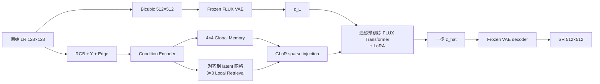

# GLoR 用于一步 FluxSR 遥感超分的技术文档

## 1. 任务与目标

当前任务是在 AID 成对数据上实现 4 倍超分：

```text
128×128 LR → 512×512 SR
```

数据划分仍严格读取每对 HR/LR JSON 中的 `split` 字段。训练只使用
`train`，测试只使用 `test`。

基础模型由两部分组成：

1. FLUX.1-dev 提供 VAE、tokenizer、CLIP/T5 文本编码器和调度器；
2. `SR_TRANSFORMER_DIR` 提供遥感数据预训练的 FLUX Transformer 权重。

本方案不是再次使用原始 OminiControl 条件生成流程，而是在已经有效的
一步 FluxSR-FTD 主干中加入 GLoR（Global-Local Observation Retrieval）
控制，以提高 LR 观测信息在生成主分支中的吸收效率。

## 2. 为什么不直接沿用原来的 OminiControl 超分

原 GLoR/OminiControl 实现面向通用条件生成：

```text
噪声生成分支 + LR 条件分支 + 文本分支 → 多步扩散生成
```

该范式用于严格成对的遥感超分时存在几个问题：

1. 超分目标强调与唯一 HR 真值的像素一致性，而通用条件生成允许多解；
2. 额外 LR 条件分支增加计算，但不能保证条件被主分支稳定吸收；
3. 多步生成更容易改善感知质量，却可能牺牲 PSNR-Y 和 SSIM-Y；
4. 原版 GLoR 在大量中后层反复执行局部 K/V 投影，训练速度较慢；
5. 单纯流匹配损失与最终 PSNR/SSIM 评价目标之间存在偏差。

当前 FluxSR 已经把 bicubic 上采样 LR 的 VAE latent 作为一步恢复起点
`z_L`。因此没有必要再复制一个 OminiControl 图像条件分支。GLoR 在这里
只负责把原始 LR 的全局与局部观测证据注入同一个生成分支。

## 3. 总体结构



关键点是：

- `z_L` 提供强像素初始化；
- GLoR 提供显式 LR 观测检索；
- LoRA 学习任务相关的流场修正；
- VAE、文本编码器和 Transformer 原始权重保持冻结。

## 4. GLoR 的超分专用实例化

### 4.1 观测特征

原始 LR RGB 图像记为 \(I_{LR}\)。为使控制特征直接服务于 Y 通道
PSNR/SSIM，条件编码器输入扩展为：

\[
X_{obs} = [R,G,B,Y,E]
\]

其中：

\[
Y=0.299R+0.587G+0.114B
\]

\(E\) 是由 Sobel 水平和垂直梯度得到的亮度边缘幅值。RGB 保留颜色与
纹理信息，Y 强化主评价通道，边缘特征强化道路、建筑轮廓等遥感结构。

5 通道观测经过轻量 CNN：

```text
Conv(5→64) → SiLU → Conv(64→128) → SiLU → Conv(128→512)
```

得到条件特征 \(F_{obs}\)。

### 4.2 全局观测记忆

对 \(F_{obs}\) 做 4×4 自适应平均池化，得到16个全局 token：

\[
M_g \in \mathbb{R}^{B\times16\times C_c}
\]

它用于提供场景类别、整体纹理密度、颜色分布和全局结构上下文。

对某层生成 hidden states \(H\)，全局检索为：

\[
A_g=\operatorname{softmax}
\left(\frac{(HW_q)(M_gW_k)^T}{\sqrt{C_c}}\right)
\]

\[
G=A_g(M_gW_v)W_o
\]

### 4.3 局部观测检索

条件特征被双线性对齐到 FLUX packed latent token 网格。512×512 图像
经过 FLUX VAE 与 2×2 latent packing 后，对应32×32、共1024个目标
token。

在每个目标 token 的同位置周围展开3×3观测窗口：

\[
M_l\in\mathbb{R}^{B\times1024\times9\times C_c}
\]

先让全局结果调制局部 query：

\[
Q_l=(H+G)W_q^l
\]

然后在每个目标位置自己的9个局部候选中检索：

\[
A_l=\operatorname{softmax}
\left(\frac{Q_l(M_lW_k^l)^T}{\sqrt{C_c}}\right)
\]

\[
L=A_l(M_lW_v^l)W_o^l
\]

这样不会进行全图无约束匹配，每个 HR latent token 只从其对应 LR
邻域提取结构和纹理证据。

### 4.4 融合与门控注入

三路特征通过瓶颈 MLP 融合：

\[
\Delta H=\operatorname{MLP}([H,G,L])
\]

本实现使用 `fusion_dim=1024`，在保持三路融合的同时降低原始
3072维全宽 MLP 的参数量与计算量。

第 \(b\) 个注入层的输出为：

\[
H_b'=H_b+\alpha_b\Delta H_b
\]

每个注入层具有独立可训练门控 \(\alpha_b\)。本方案使用
`alpha_init=0.001`：初始扰动很小，同时避免严格零初始化使检索分支在
第一个优化步没有梯度。

## 5. 稀疏多深度注入

标准 FLUX Transformer 有19个 dual blocks 和38个 single blocks。原版
`middle_late` 会在大量 block 中重复运行 GLoR。当前实现选择：

```yaml
inject_dual_indices: [6, 12, 18]
inject_single_indices: [12, 24, 36]
```

这6个位置覆盖中层、后层和末层：

- 中层注入帮助恢复主要空间结构；
- 后层注入帮助恢复纹理和边缘；
- 末层注入在输出前校正局部观测一致性。

全局与局部 memory 的 K/V 在同一训练 step 中只投影一次，随后由6个
注入位置共享。每层 query 仍由该层 hidden states 独立生成，因此没有
破坏逐层自适应检索。

## 6. 与一步 FluxSR-FTD 的结合

HR latent、LR latent 和高斯噪声分别记为 \(z_0,z_L,\epsilon\)。在
\(t\in[t_L,1]\) 上构造：

\[
x_t=\frac{1-t}{1-t_L}z_L+
\frac{t-t_L}{1-t_L}\epsilon
\]

目标速度为：

\[
v^*=\epsilon-z_0
\]

GLoR context 从原始128×128 LR 计算一次，并同时送入：

1. 随机时刻 \(t\) 的 FTD 速度预测；
2. 固定时刻 \(t_L\) 的一步重建预测。

一步恢复为：

\[
\hat z_0=z_L-t_Lv_\theta(z_L,t_L;C_{GLoR})
\]

其中 \(C_{GLoR}\) 表示全局与局部 LR 观测记忆。

因此 GLoR 不改变 FluxSR 的一步推理形式，只改变冻结 Transformer 内
选定层的 hidden states。

## 7. 训练目标

沿用当前效果最好的 Y 保真损失配方：

```yaml
ftd_weight: 0.25
mse_weight: 10.0
l1_weight: 1.0
y_mse_weight: 10.0
y_l1_weight: 1.0
ssim_weight: 0.5
lpips_weight: 0.02
tv_lpips_gamma: 0.1
adl_weight: 0.0
```

总损失为：

\[
\mathcal L =
0.25\mathcal L_{FTD}
+10\mathcal L_{RGB-MSE}
+\mathcal L_{RGB-L1}
+10\mathcal L_{Y-MSE}
+\mathcal L_{Y-L1}
+0.5(1-SSIM_Y)
+0.02\mathcal L_{perceptual}
\]

Y-MSE、Y-L1 和 SSIM-Y 使用与测试一致的4像素裁边。

## 8. 参数更新策略

### 冻结

- 遥感预训练 FLUX Transformer 原始参数；
- FLUX VAE；
- CLIP/T5 文本编码器；
- tokenizer 与 scheduler。

### 训练

- 从头初始化的 FluxSR rank-16 LoRA；
- GLoR condition encoder；
- 全局 attention；
- 局部 retrieval attention；
- 融合 MLP；
- scale embedding；
- 6个独立注入门控。

GLoR 实验和基线使用相同的遥感 Transformer，并分别初始化 rank-16 LoRA。GLoR 实验联合训练 LoRA 与 GLoR。两个配置均使用 AdamW、`2e-5` 学习率和余弦退火。

| 项目 | 无GLoR基线 | GLoR实验 |
|---|---:|---:|
| 遥感Transformer | 同一预训练权重 | 同一预训练权重 |
| LoRA初始化 | 新建 | 新建 |
| LoRA rank | 16 | 16 |
| 初始学习率 | 2e-5 | 2e-5 |
| 损失权重 | Y保真配方 | 同一Y保真配方 |
| 唯一方法差异 | 无 | 加入GLoR |

配置关闭 gradient checkpointing，以便在同一次前向和反向传播中复用 GLoR K/V 缓存。

## 9. 代码映射

| 文件 | 作用 |
|---|---|
| `glor_control/control.py` | 全局记忆、局部检索、Y/边缘观测、稀疏注入与K/V缓存 |
| `glor_control/utils.py` | 3×3局部窗口展开 |
| `omini/pipeline/flux_omini.py` | 在 dual/single FLUX blocks 后注入 GLoR delta |
| `omini/train_flux/trainer.py` | 冻结主干，将GLoR参数与LoRA参数共同交给优化器 |
| `omini/train_flux/aid_fluxsr_ftd.py` | 从原始LR构建context，并用于两次FluxSR速度预测 |
| `omini/train_flux/train_aid_fluxsr_ftd.py` | 传入GLoR配置、保存样例和SwanLab记录 |
| `tools/infer_aid_fluxsr_ftd.py` | 配对加载 LoRA 与 GLoR 并生成超分图像 |
| `train/config/aid_fluxsr_ftd_rsbackbone_glor.yaml` | 完整实验配置 |
| `train/script/train_aid_fluxsr_ftd_rsbackbone_glor.sh` | ×4 GLoR 训练入口 |

## 10. 训练方法

`default.safetensors` 和 `glor_control.pt` 应成对保存与使用。数据准备、训练命令和输出位置见[超分辨率使用说明](../../README.md#super-resolution-on-aid)。

## 11. 推理

启用 GLoR 时，推理程序从同一检查点目录加载 `glor_control.pt`，缺少该文件时会报错。

推理命令和输出文件见[超分辨率使用说明](../../README.md#super-resolution-on-aid)。

## 12. 论文表述建议

> 在一步遥感超分中，我们将全局-局部观测检索控制嵌入以
> bicubic-LR latent 为起点的流轨迹恢复网络。不同于额外构建条件生成
> 分支，每个目标 latent token 在稀疏的中后层直接检索与其空间对应的
> LR 局部邻域，同时接受紧凑全局场景记忆调制。亮度与边缘增强观测使
> 控制证据与遥感超分的结构保真目标一致；门控残差注入则在冻结遥感
> DiT 主干的前提下保持已有生成能力。
